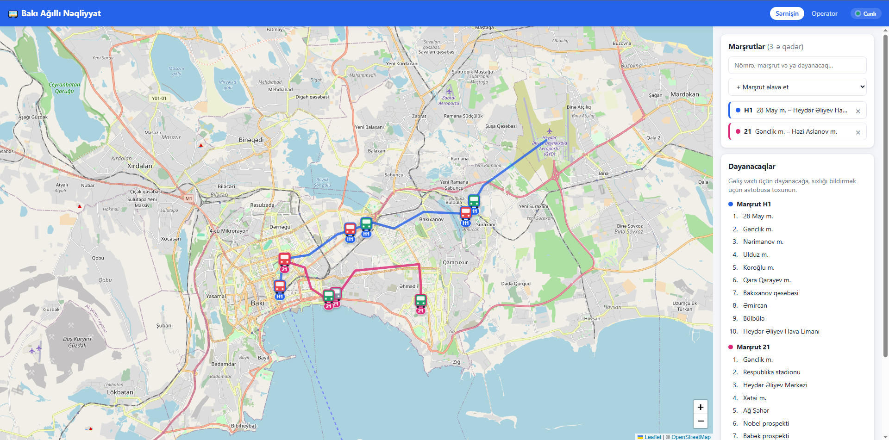
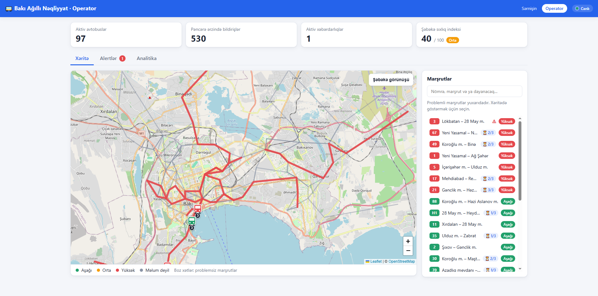
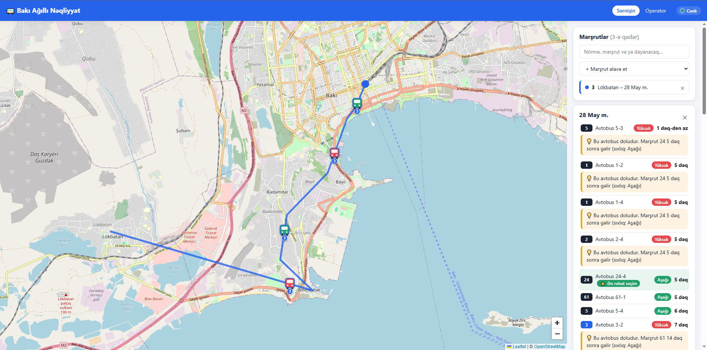
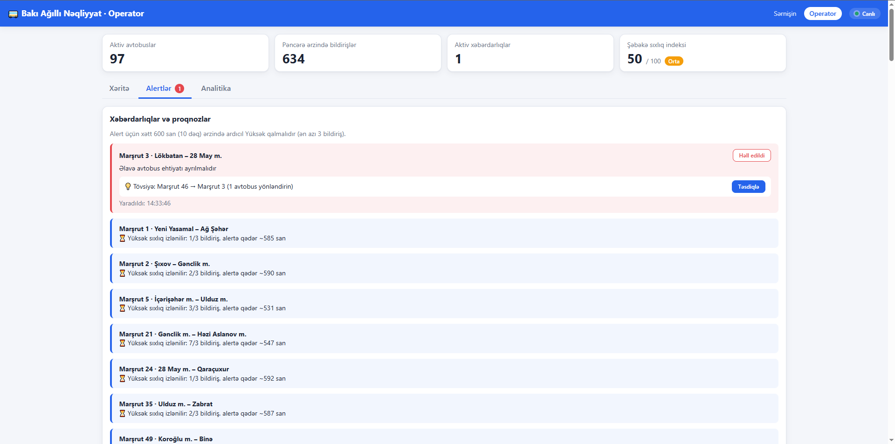
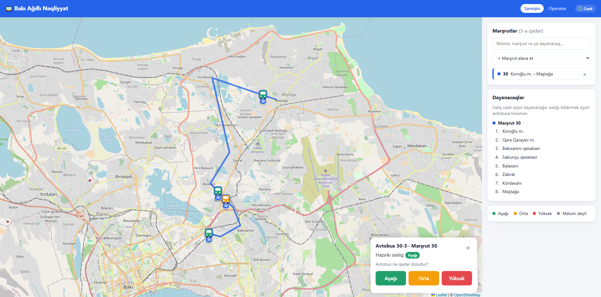
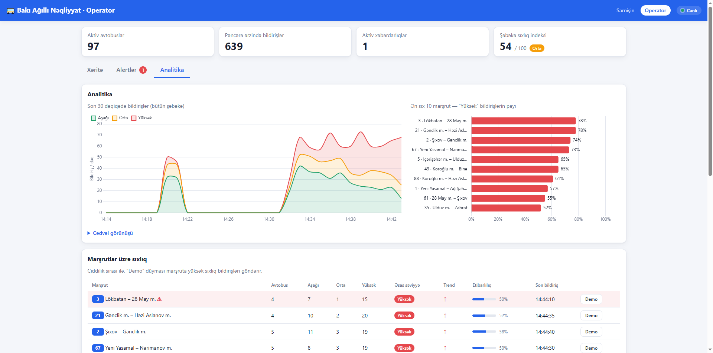
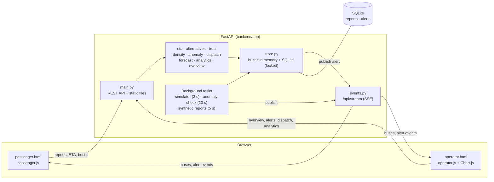

# Baku Smart Transit & Crowdsourcing Engine

> **Bakı Ağıllı Nəqliyyat və Kraudsorsinq Mühərriki** — Bakı avtobus şəbəkəsi üçün hakaton
> prototipi. Sərnişinlər avtobusların xəritədə canlı hərəkətini izləyir, dayanacağa gəliş
> vaxtını görür və avtobusun nə qədər dolu olduğunu (Aşağı / Orta / Yüksək) bildirir.
> Operator paneli bu bildirişləri real vaxtda toplayır: marşrut müəyyən müddət ardıcıl
> olaraq yüksək sıxlıqda qaldıqda xəbərdarlıq yaradır, sakit marşrutdan avtobusun
> yönləndirilməsini tövsiyə edir, 15 dəqiqəlik proqnoz və analitika təqdim edir.
> Avtobusların GPS mövqeləri simulyasiya olunur; marşrut nömrələri və dayanacaq adları realdır.
> Ətraflı texniki izah: [docs/TEXNIKI_IZAH.md](docs/TEXNIKI_IZAH.md).

Hackathon prototype: live (simulated) Baku buses, passenger crowd-density reports,
anomaly alerts with smart dispatch, forecasts and analytics for operators.

- Passenger page: `/passenger.html` — map, stop arrival times, report how full a bus is.
- Operator page: `/operator.html` — density map, alerts, forecast, analytics.

Stack: Python 3.11+, FastAPI, SQLite, vanilla HTML/JS, Leaflet, Chart.js (both vendored).

## Features

**Passenger**
- Live map of up to 3 selected routes (each in its own colour), buses as icons coloured by crowd density.
- Stop arrival times (ETA) for every bus serving the stop, with each bus's current density.
- Alternatives: under a crowded bus, a less crowded one arriving within 10 minutes; "⭐ Ən rahat seçim" for the calmest bus in the next 15 minutes.
- One-tap density report (Aşağı / Orta / Yüksək), rate-limited per device; selection is remembered between visits.

**Operator**
- Network map: problem routes thick and coloured, the rest calm grey; "Şəbəkə görünüşü" resets the view.
- Anomaly alerts ("Əlavə avtobus ehtiyatı ayrılmalıdır") when a route stays "high" for the whole window, with a live "being watched" counter before that.
- Smart dispatch: a recommended donor route and a "Təsdiqlə" button that moves a bus and resolves the alert.
- 15-minute forecast with trend arrows and early warnings; report confidence per route.
- Analytics: 30-minute report timeline, top 10 crowded routes, network density index (0–100).
- Real-time updates over Server-Sent Events ("Canlı"), with automatic fallback to polling.

**Simulation & data**: 25 real Baku route numbers, 89 real stop names, 97 simulated buses
(more on busy hub routes), background synthetic reports with a rush-hour wave.

## Screenshots

| Passenger | Operator |
|---|---|
|  |  |
|  |  |
|  |  |

_Placeholders: see [docs/screenshots/README.md](docs/screenshots/README.md) for what each image should show._

## Run

### Locally

```bash
pip install -r requirements.txt
cd backend
uvicorn app.main:app --reload
```

Open http://127.0.0.1:8000/. (On Windows, `localhost` is tried as IPv6 first; uvicorn
listens on IPv4 only, so every new connection via `localhost` can lose up to ~2s.)

**Demo mode** (alerts and forecast warnings within a couple of minutes) on Windows:

```powershell
powershell -ExecutionPolicy Bypass -File .\run_demo.ps1          # add -Fresh for an empty demo database
```

It loads `.env.demo`, uses `backend/demo.db` (separate from normal data) and opens the browser.
The same by hand, PowerShell:

```powershell
$env:ANOMALY_WINDOW_SEC = "30"; $env:RUSH_PERIOD_MIN = "6"
uvicorn app.main:app
```

### Docker

```bash
docker compose up --build                          # normal settings
docker compose --env-file .env.demo up --build     # demo settings
```

Open http://127.0.0.1:8000/. Reports and alerts are kept in the `transit-data` volume.

## Tests

```bash
pytest -q
```

The suite covers each module (simulator, ETA, anomaly rule, dispatch, trust, forecast,
alternatives, analytics, overview, live stream), the HTTP API, store concurrency, and one
end-to-end flow (`tests/test_integration.py`: report → density → alert → dispatch → resolved).
Tests use an in-memory database and fixed timestamps; no browser/UI tests.

## Demo script for judges (≈ 5 minutes)

Start with `run_demo.ps1 -Fresh` (or Docker with `.env.demo`).

1. **Passenger page** (`/passenger.html`): buses move along the selected route. Add a second
   route from the search box (e.g. `H1`); each route gets its own colour.
2. Click the **28 May m.** stop: arrival times from several routes, density badges and
   "⭐ Ən rahat seçim".
3. Click a bus → **Yüksək**: "Təşəkkürlər, bildirişiniz qəbul edildi". Click it again at once:
   the rate limit answers in Azerbaijani.
4. **Operator page** (`/operator.html`, "Canlı" in the header): summary cards, the network
   map, routes sorted by severity. In **Alertlər**, routes with recent "high" reports show
   "⏳ Yüksək sıxlıq izlənilir: n/3".
5. **Analitika** tab → press **Demo** on a route: an alert appears at once (toast, sound,
   the Alertlər tab flashes, the route turns red on the map).
6. **Alertlər** tab: the alert carries "Tövsiyə: Marşrut X → Marşrut Y". Press **Təsdiqlə**:
   a bus moves to the crowded route and the alert is resolved.
7. After 1–2 minutes the synthetic rush hour shows **forecast warnings**
   ("⚠ Proqnoz: 15 dəq sonra Yüksək sıxlıq gözlənilir") and ↑ trend arrows; Analitika charts fill up.

## Architecture



## API

| Method | Path | Purpose |
|---|---|---|
| GET | `/api/health` | Liveness check |
| GET | `/api/stream` | Server-Sent Events: `buses` every 2 s, `alert` on create/resolve |
| GET | `/api/routes` | Routes with stops and fleet size |
| GET | `/api/buses?route_id=` | Live bus positions and latest density (optionally one route) |
| GET | `/api/stops?route_id=` | Stops of a route |
| GET | `/api/stops/{stop_id}/eta` | Arrival times at a stop, with suggestions and "most comfortable" flag |
| POST | `/api/reports` | Passenger density report `{route_id, bus_id, level, client_id, lat?, lon?}` (422 invalid / too far, 429 rate limit) |
| GET | `/api/operator/overview` | Everything the operator page needs in one batched response |
| GET | `/api/operator/density` | Per-route density, counts, confidence, last report |
| GET | `/api/operator/forecast` | Per-route 15-minute forecast, trend, early warning |
| GET | `/api/operator/pending` | Routes heading toward an alert (high run, no alert yet) |
| GET | `/api/operator/analytics` | 30-minute timeline, top 10 crowded routes, density index |
| GET | `/api/operator/alerts` | Alerts, active first |
| POST | `/api/operator/alerts/{id}/resolve` | Mark an alert resolved |
| POST | `/api/operator/alerts/{id}/dispatch` | Move a bus from the recommended donor route and resolve (409 if not possible) |
| POST | `/api/demo/flood-high?route_id=` | Demo only: backdated "high" reports so an alert fires at once |

Interactive docs: http://127.0.0.1:8000/docs (generated by FastAPI).

## Settings

All tunables live in `backend/app/config.py`. These can be set as environment variables:

| Variable | Default | Meaning |
|---|---|---|
| `DB_PATH` | `backend/data.db` | SQLite file for reports and alerts |
| `ANOMALY_WINDOW_SEC` | `600` | How long a route must stay "high" before an alert (demo: `30`) |
| `RUSH_PERIOD_MIN` | `30` | Length of the synthetic rush-hour wave (demo: `6`) |
| `SYNTHETIC_REPORTS` | `1` | Generate background demo reports (`0` = off) |
| `SIM_SEED` | `42` | Seed for the buses' start positions |
| `MAX_REPORT_DISTANCE_M` | `0` | Proximity check, see below |

### Proximity check (`MAX_REPORT_DISTANCE_M`)

When the passenger's browser shares its location, a report can be rejected if the
passenger is too far from the bus ("Avtobusdan çox uzaqdasınız"). It is **off by
default** (`0`) because bus positions are simulated, so a real phone is never near them.
With real bus GPS, enable it with a distance in metres, e.g. `MAX_REPORT_DISTANCE_M=500`.

## Data note

Route numbers and stop names are real; coordinates are approximate and stop sequences
are simplified demo data, not official BakuBus routes.

## Limitations

- Bus positions are simulated; there is no connection to real BakuBus GPS yet.
- Route geometry is straight lines between approximate stop coordinates, not real streets.
- Bus positions live in memory: after a restart, dispatched buses return to their own routes
  (reports and alerts are kept in SQLite).
- One server process with one SQLite connection behind a lock: fine for a demo, not for
  city-scale traffic (see future work in the technical document).
- Client IDs are anonymous browser IDs, so the rate limit can be bypassed by clearing storage;
  the confidence score dampens, but does not prevent, coordinated false reports.
- No authentication: the operator page and the demo endpoint are open.
- The forecast is a simple linear trend over the last 10 minutes, not a trained model.
- Map tiles come from OpenStreetMap and need internet access; everything else works offline.

## Team

| Member | Role |
|---|---|
| Ülvi Mustafayev | Backend & API |
| Anar Hümmətli | Frontend & UI/UX |
| Xizri Saxrayev | AI integration, testing & documentation |

## AI declaration

Every AI-assisted change is logged in `AI_DECLARATION.md` (English) and
`AI_DECLARATION_AZ.md` (Azərbaycanca).
