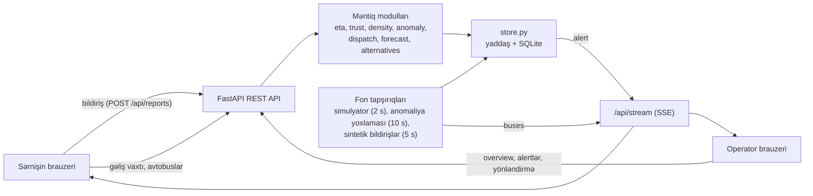

# Bakı Ağıllı Nəqliyyat və Kraudsorsinq Mühərriki — Texniki izah

**Komanda:** Ülvi Mustafayev (backend və API), Anar Hümmətli (frontend və UI/UX),
Xizri Saxrayev (süni intellekt inteqrasiyası, testləşdirmə və sənədləşmə).

---

## 1. Problemin konteksti

Bakının ictimai nəqliyyat şəbəkəsində sərnişin axını gün ərzində qeyri-bərabər paylanır:
pik saatlarda mərkəzi marşrutlarda (28 May, Gənclik, Koroğlu, Nizami kimi qovşaqlardan
keçən xətlərdə) avtobuslar həddindən artıq dolu olur, eyni zamanda kənar marşrutlarda
avtobuslar yarıboş hərəkət edir. Bu vəziyyətdə iki əsas çətinlik yaranır:

- **Sərnişin** avtobusun nə vaxt gələcəyini və nə dərəcədə dolu olduğunu əvvəlcədən bilmir,
  buna görə də daha rahat alternativ seçə bilmir.
- **Operator** (dispetçer) hansı marşrutun real vaxtda sıxlıq yaşadığını gec öyrənir və
  avtobus ehtiyatını operativ şəkildə yenidən bölüşdürə bilmir.

Avtobusların dolulığı haqqında sensor məlumatı hər yerdə mövcud deyil. Layihənin əsas
ideyası bu boşluğu **kraudsorsinq** — sərnişinlərin özlərinin göndərdiyi sadə bildirişlər —
vasitəsilə doldurmaqdır.

## 2. Təklif olunan həll

Sistem iki veb səhifədən və onlara xidmət edən vahid serverdən ibarətdir.

**Sərnişin paneli** (`/passenger.html`):
- seçilmiş (üçə qədər) marşrut və onların avtobusları xəritədə canlı göstərilir;
- dayanacaq seçildikdə hər avtobusun gəliş vaxtı və cari sıxlığı göstərilir;
- dolu avtobus üçün 10 dəqiqə ərzində gələn daha sakit alternativ, növbəti 15 dəqiqə
  üçün isə "Ən rahat seçim" təklif olunur;
- sərnişin bir toxunuşla avtobusun sıxlığını (Aşağı / Orta / Yüksək) bildirir.

**Operator paneli** (`/operator.html`):
- şəbəkə xəritəsi, ümumi göstəricilər və marşrutların ciddilik sırası ilə siyahısı;
- marşrut müəyyən müddət ərzində ardıcıl "Yüksək" qaldıqda avtomatik xəbərdarlıq
  ("Əlavə avtobus ehtiyatı ayrılmalıdır") və ondan əvvəl "izlənilir" göstəricisi;
- **ağıllı yönləndirmə**: sakit marşrutdan avtobus götürülməsi tövsiyəsi və bir düymə ilə
  ("Təsdiqlə") onun icrası;
- 15 dəqiqəlik proqnoz, erkən xəbərdarlıqlar, bildirişlərin etibarlılıq göstəricisi və analitika.

Avtobusların GPS mövqeləri simulyasiya olunur. Marşrut nömrələri (25 marşrut) və
dayanacaq adları (89 dayanacaq) realdır, koordinatlar isə təxminidir.

## 3. Arxitektura və məlumat axını

Sistem bir FastAPI prosesində işləyir. Server həm REST API-ni, həm də statik frontend
fayllarını təqdim edir.



**Bildirişin yolu:**
1. Sərnişin avtobusa toxunur və səviyyəni seçir. Brauzer anonim cihaz identifikatorunu
   (`client_id`) və icazə verilibsə, mövqeyi göndərir.
2. Server avtobusun həmin marşruta aid olduğunu, sürət məhdudiyyətini və (aktiv olduqda)
   məsafəni yoxlayır, bildirişi SQLite-a yazır və avtobusun cari sıxlığını yeniləyir.
3. Dərhal həmin marşrut üçün anomaliya qaydası yoxlanılır. Qayda ödənilərsə, xəbərdarlıq
   yaradılır, ona yönləndirmə tövsiyəsi əlavə olunur və SSE vasitəsilə bütün açıq
   operator səhifələrinə dərhal ötürülür.
4. Operator səhifəsi bütün lazımi məlumatı bir sorğu ilə (`/api/operator/overview`) alır.
   Avtobus mövqeləri isə hər 2 saniyədən bir SSE ilə gəlir.

**Fon tapşırıqları:** simulyator hər 2 saniyədən bir avtobusları hərəkət etdirir;
anomaliya yoxlaması hər 10 saniyədən bir bütün marşrutlara baxır; sintetik bildiriş
generatoru demo üçün hər 5 saniyədən bir "pik saat" dalğasına uyğun bildirişlər yaradır.

## 4. Texnologiyalar və seçim səbəbləri

| Texnologiya | Niyə seçilib |
|---|---|
| **Python 3, FastAPI** | Asinxron server, Pydantic ilə avtomatik giriş yoxlaması, avtomatik API sənədləri (`/docs`); kod qısa və oxunaqlıdır. |
| **SQLite (standart `sqlite3`)** | Ayrıca server tələb etmir, tək fayl kimi saxlanılır, prototip üçün kifayətdir; indekslər zaman aralığı sorğularını sürətləndirir. |
| **Vanilla HTML/CSS/JavaScript** | Yığma (build) mərhələsi yoxdur, kod birbaşa oxunur və münsiflər tərəfindən asanlıqla yoxlanıla bilər. |
| **Leaflet + OpenStreetMap** | Açıq və pulsuz xəritə həlli; kitabxana layihəyə daxil edilib (CDN-dən asılı deyil). |
| **Chart.js** | Yüngül qrafik kitabxanası; qrafiklər bir dəfə yaradılır, sonra yalnız məlumat yenilənir. |
| **Server-Sent Events (SSE)** | Serverdən brauzerə birtərəfli canlı ötürmə üçün WebSocket-dən sadədir; brauzer avtomatik yenidən qoşulur, xəta olduqda səhifələr sorğu (polling) rejiminə keçir. |
| **pytest** | Sadə və geniş yayılmış test aləti; FastAPI-nin test müştərisi ilə API-ni server işə salmadan yoxlamaq mümkündür. |
| **Docker** | Layihəni istənilən kompüterdə bir əmrlə işə salmaq üçün. |

## 5. Layihənin strukturu

```
baku-smart-transit/
├── backend/app/
│   ├── main.py          FastAPI tətbiqi: API marşrutları, fon tapşırıqları, statik fayllar
│   ├── config.py        Bütün tənzimlənən parametrlər (mühit dəyişənləri ilə)
│   ├── models.py        Pydantic modelləri (Stop, Route, Bus, Report, Alert və s.)
│   ├── store.py         Yaddaşdakı vəziyyət + SQLite (kilid ilə qorunan)
│   ├── routes_data.py   25 marşrut, 89 dayanacaq, marşrutlar üzrə avtobus sayı
│   ├── simulator.py     GPS simulyatoru
│   ├── eta.py           Gəliş vaxtının hesablanması
│   ├── alternatives.py  Dolu avtobusa alternativ, "Ən rahat seçim"
│   ├── trust.py         Sürət məhdudiyyəti, məsafə yoxlaması, təzəlik çəkisi, etibarlılıq
│   ├── density.py       Marşrut üzrə sıxlıq xülasəsi
│   ├── anomaly.py       Anomaliya qaydası, xəbərdarlıqlar, "izlənilir" vəziyyəti
│   ├── dispatch.py      Ağıllı yönləndirmə
│   ├── forecast.py      15 dəqiqəlik proqnoz
│   ├── analytics.py     Analitika və şəbəkə sıxlıq indeksi
│   ├── overview.py      Operator səhifəsi üçün toplu cavab
│   ├── events.py        SSE üçün daxili yayım mexanizmi
│   └── synthetic.py     Demo üçün sintetik bildirişlər
├── frontend/            passenger.html, operator.html, js/, css/, vendor/ (Leaflet, Chart.js)
├── tests/               16 test faylı, 199 test
├── docs/                Bu sənəd, ekran görüntüləri
├── Dockerfile, docker-compose.yml, .env.demo, run_demo.ps1
└── README.md, AI_DECLARATION.md, AI_DECLARATION_AZ.md
```

## 6. Əsas alqoritmlər

### 6.1. Gəliş vaxtı (ETA) — `eta.py`

Hər marşrut gediş-dönüş yolu kimi modelləşdirilir: A→B→C→D→C→B→A. Simulyatorda
avtobus bir dayanacaqdan növbətisinə 15 addımda (15 × 2 s = 30 saniyə) çatır. Avtobus
yolun `i`-ci nöqtəsindən çıxıb növbəti dayanacağa qədər yolun `progress` hissəsini qət
edibsə, `k`-cı nöqtəyə qədər qalan vaxt belə hesablanır:

```
qalan seqmentlər = (k − i) mod (yolun uzunluğu) − progress
vaxt = qalan seqmentlər × 30 s × SIM_TIME_SCALE
```

Dayanacaq gediş-dönüş yolunda iki dəfə görünə bilər; ən yaxın gəliş götürülür. Avtobus
dayanacağı yenicə keçibsə, növbəti gəliş tam dövrə sonradır. Xəritədə hərəkətin canlı
görünməsi üçün simulyator real həyatdan sürətli işləyir; sərnişinə göstərilən vaxt
`SIM_TIME_SCALE = 5` əmsalı ilə real miqyasa gətirilir: bir seqment 30 s × 5 = 2,5 dəqiqə.

### 6.2. Anomaliya qaydası — `anomaly.py`

Marşrut o zaman anomal hesab olunur ki, onun **ən son bildirişləri** fasiləsiz "Yüksək"
seriyası təşkil etsin (arada "Aşağı" və ya "Orta" olmasın), bu seriyada **ən azı 3
bildiriş** olsun və seriyanın birinci və sonuncu bildirişi arasındakı müddət **ən azı
`ANOMALY_WINDOW_SEC`** (standart olaraq 600 s, demo rejimində 30 s) olsun.

- Qayda hər yeni bildirişdən sonra və fon tapşırığı ilə hər 10 saniyədən bir yoxlanılır.
- Hər marşrut üçün eyni anda yalnız bir aktiv xəbərdarlıq ola bilər.
- Operator xəbərdarlığı həll etdikdən sonra marşrut yalnız **yeni** "Yüksək" bildiriş
  gəldikdə təkrar xəbərdarlıq verə bilər.
- Sorğu yalnız son iki pəncərə (+1 dəqiqə) ərzindəki bildirişləri oxuyur. Bu, son
  bildirişi pəncərə daxilində olan istənilən uyğun seriyanı aşkar etmək üçün kifayətdir.
- **"İzlənilir" vəziyyəti:** xəbərdarlıq yaranmazdan əvvəl operatora seriyadakı bildiriş
  sayı (məs., 2/3) və pəncərənin dolmasına qalan saniyələr göstərilir. Bu göstərici
  qayda ilə eyni funksiyalardan istifadə edir, buna görə də onunla həmişə uyğundur.

### 6.3. Ağıllı yönləndirmə — `dispatch.py`

Xəbərdarlıq yarananda donor marşrut seçilir. **Namizədlər** — digər marşrutlardan:
sakit olanlar (əsas səviyyə "Aşağı" və ya pəncərədə bildiriş yoxdur), aktiv xəbərdarlığı
olmayanlar və ən azı 3 avtobusu olanlar. **Seçim ardıcıllığı:**

1. ən çox "Aşağı" bildirişi olan;
2. ən az "Orta"/"Yüksək" bildirişi olan;
3. mərkəzi qovşaqlardan (28 May, Koroğlu, Gənclik, Nizami) keçməyən;
4. daha çox avtobusu olan.

Tövsiyə xəbərdarlığa əlavə olunur: "Tövsiyə: Marşrut X → Marşrut Y (1 avtobus
yönləndirin)". Mətn nömrədən asılı şəkilçi problemini aradan qaldırmaq üçün oxla
yazılır. Operator "Təsdiqlə" düyməsini basdıqda donor marşrutun bir avtobusu hədəf
marşrutun başlanğıcına keçirilir, onun köhnə sıxlıq məlumatı sıfırlanır və xəbərdarlıq
həll olunmuş kimi qeyd edilir. Donorda artıq kifayət qədər avtobus qalmayıbsa, server
409 cavabı qaytarır.

### 6.4. Bildirişlərin etibarlılığı — `trust.py`

- **Sürət məhdudiyyəti:** eyni cihaz eyni avtobus üçün 60 saniyədə bir dəfədən çox
  bildiriş göndərə bilməz (HTTP 429, Azərbaycan dilində mesaj).
- **Məsafə yoxlaması:** sərnişinin mövqeyi göndərilibsə və avtobusdan
  `MAX_REPORT_DISTANCE_M`-dən uzaqdırsa, bildiriş rədd edilir. GPS simulyasiya olunduğu
  üçün standart olaraq söndürülüb (0); real GPS ilə, məsələn, 500 m qoyula bilər.
- **Təzəlik çəkisi:** bildirişin çəkisi indi 1,0-dan pəncərənin sonunda 0-a qədər xətti
  azalır. Marşrutun əsas səviyyəsi bu çəkili saylarla müəyyən edilir; beləliklə, təzə
  "Aşağı" bildirişi köhnəlməkdə olan bir neçə "Yüksək" bildirişindən üstün ola bilər.
- **Etibarlılıq (0–1):** `min(1, unikal cihaz sayı / 5) × orta təzəlik`. Bir nəfərin
  təkrar bildirişləri etibarlılığı artırmır; çoxlu müstəqil və təzə bildirişlər onu
  1-ə yaxınlaşdırır.

### 6.5. Proqnoz — `forecast.py`

1. Bildirişlər bal alır: Aşağı = 1, Orta = 2, Yüksək = 3.
2. Son 10 dəqiqə birdəqiqəlik intervallara bölünür və hər intervalın orta balı tapılır.
3. Bu nöqtələrdən ən kiçik kvadratlar üsulu ilə düz xətt keçirilir.
4. Xətt 15 dəqiqə irəli uzadılır; nəticə 1–3 aralığına məhdudlaşdırılır və səviyyəyə
   çevrilir (< 1,5 Aşağı, < 2,5 Orta, əks halda Yüksək).
5. Meyl dəqiqədə +0,05-dən böyükdürsə "artır", −0,05-dən kiçikdirsə "azalır", əks halda
   "sabit" sayılır.
6. Proqnoz "Yüksək", hazırkı səviyyə isə "Yüksək" deyilsə, operatora **erkən
   xəbərdarlıq** göstərilir (real xəbərdarlıq yaradılmır).

### 6.6. Sərnişin üçün alternativlər — `alternatives.py`

- Hər "Yüksək" sıxlıqlı avtobus üçün həmin dayanacağa onunla eyni vaxtda və ya ondan
  sonra gələn, "Yüksək" olmayan (Aşağı, Orta və ya məlum olmayan) ən yaxın avtobus
  axtarılır. İstənilən marşrut nəzərə alınır. Əlavə gözləmə 10 dəqiqədən çox deyilsə,
  bu avtobus tövsiyə olunur.
- Növbəti 15 dəqiqə ərzində gələn avtobuslar arasında sıxlığı məlum və ən aşağı olan
  "Ən rahat seçim" kimi işarələnir; sıxlığı məlum olmayan avtobus bu nişanı almır.

### 6.7. Analitika və sintetik bildirişlər

- **Şəbəkə sıxlıq indeksi (0–100):** bütün şəbəkə üzrə çəkili orta bal 1–3 aralığından
  0–100 şkalasına çevrilir (hamısı Aşağı = 0, hamısı Yüksək = 100).
- **Sintetik bildirişlər** (yalnız demo üçün): hər 5 saniyədən bir 5 bildiriş yaradılır.
  Pik saat dalğası (`RUSH_PERIOD_MIN`, standart 30 dəqiqə, demoda 6) mərkəzi marşrutlarda
  "Yüksək" ehtimalını 15%-dən 80%-ə qədər artırır, kənar marşrutlar isə əsasən "Aşağı" qalır.

## 7. Testləşdirmə yanaşması və nəticələr

- **Həcm:** 16 test faylı, **199 test**, hamısı uğurla keçir (`pytest -q`).
- **Modul testləri:** simulyator, ETA, anomaliya qaydası, yönləndirmə, etibarlılıq,
  proqnoz, alternativlər, analitika, SSE, marşrut məlumatlarının bütövlüyü.
- **Sabit zaman:** zamana bağlı qaydalar (anomaliya, təzəlik, proqnoz, "izlənilir")
  saxta (sabit) zaman nişanları ilə yoxlanılır və gözləmə (sleep) tələb etmir. İnteqrasiya
  testi isə 1 saniyəlik pəncərə ilə real vaxtda təxminən 1,2 saniyə gözləyir.
- **API testləri:** bütün endpointlər FastAPI-nin test müştərisi ilə yoxlanılır; testlər
  yaddaşda yaradılan verilənlər bazasından istifadə edir və real fayla toxunmur.
- **İnteqrasiya testi** (`tests/test_integration.py`): yalnız HTTP API vasitəsilə tam
  ssenari — bildiriş → sıxlıq → "izlənilir" → tövsiyə ilə xəbərdarlıq → yönləndirmə →
  həll olunmuş xəbərdarlıq → avtobusun yeni marşrutda hərəkəti.
- **Uyğunluq testi:** toplu `/api/operator/overview` cavabının ayrı-ayrı endpointlərin
  nəticələri ilə tam eyni olduğu yoxlanılır.
- **Rəng palitrası:** marşrut və sıxlıq rəngləri rəng korluğu simulyasiyası ilə ölçülüb
  seçilib.
- **Ölçülmüş performans** (2 578 bildirişli real verilənlər bazası ilə): operator
  səhifəsinin ilk görüntüsü üçün lazım olan məlumat 0,065 saniyədə hazır olur; bir
  yeniləmə 199 əvəzinə 3 SQL sorğusu ilə yerinə yetirilir.

## 8. Aşkar edilmiş və düzəldilmiş xəta: SQLite-ın paralel istifadəsi

**Simptom:** operator səhifəsində marşrutlar təxminən 30 saniyə gecikmə ilə görünürdü.

**Araşdırma:** hər endpoint ayrılıqda 1–11 millisaniyəyə cavab verirdi. Lakin səhifənin
etdiyi kimi 5–6 sorğu paralel göndərildikdə 20 yeniləmədən 13-ü uğursuz oldu, serverdə
19 xəta qeydə alındı. Xətalar arasında `sqlite3.InterfaceError: bad parameter or other API
misuse`, boş nəticələr və başqa sorğunun sətirlərindən qarışıq yaranmış natamam
məlumatlar var idi.

**Səbəb:** bir SQLite bağlantısı həm sorğuları emal edən axınlar hovuzu (thread pool),
həm də fon tapşırıqları tərəfindən **kilidsiz** paylaşılırdı (`check_same_thread=False`).
Paralel sorğular bağlantı üzərində bir-birinə qarışırdı. Hər hansı sorğunun uğursuz
olması səhifənin bütöv yenilənməsini dayandırırdı, buna görə də səhifə uğurlu yeniləmə
baş verənə qədər boş qalırdı.

**Həll:**
1. `store.py`-da bütün SQL əmrləri bir kilid altında işləyən iki köməkçi funksiyadan
   (`_query`, `_write`) keçir. Sətirlər kilid buraxılmazdan əvvəl tam oxunur.
2. Yeni `/api/operator/overview` endpointi səhifəyə lazım olan hər şeyi 3 toplu SQL
   sorğusu ilə qaytarır (əvvəl hər yeniləmədə 199 sorğu olurdu).
3. Operator səhifəsi əvvəlcə bu bir sorğu ilə xəritəni çəkir, yalnız sonra SSE və
   dövri yeniləməni başladır.

**Nəticə:** 20 yeniləmənin hamısı uğurlu oldu, server xətası qalmadı. 8 axınla eyni
anda yazma və oxuma aparan reqressiya testi əlavə olundu.

**Əlavə müşahidə:** Windows-da `localhost` ünvanı əvvəlcə IPv6 ilə yoxlanılır, uvicorn
isə yalnız IPv4-də dinləyir. Buna görə hər yeni bağlantı 2 saniyəyə qədər itirə bilər.
Sənədlərdə `http://127.0.0.1:8000` ünvanından istifadə tövsiyə olunur.

## 9. Məhdudiyyətlər

- Avtobus mövqeləri simulyasiya olunur; real BakuBus GPS məlumatı ilə əlaqə yoxdur.
- Marşrut xətləri təxmini dayanacaq koordinatları arasında düz xətlərdir, real küçələri izləmir.
- Avtobusların vəziyyəti yaddaşda saxlanılır: server yenidən başladıqda yönləndirilmiş
  avtobuslar öz marşrutlarına qayıdır (bildirişlər və xəbərdarlıqlar SQLite-da qalır).
- Bir server prosesi və kilidli bir SQLite bağlantısı prototip üçün kifayətdir, lakin
  şəhər miqyaslı yük üçün nəzərdə tutulmayıb.
- Cihaz identifikatorları anonimdir; brauzer yaddaşını təmizləməklə sürət məhdudiyyəti
  keçilə bilər. Etibarlılıq göstəricisi saxta bildirişlərin təsirini azaldır, lakin tam
  aradan qaldırmır.
- Autentifikasiya yoxdur: operator səhifəsi və demo endpointi açıqdır.
- Proqnoz son 10 dəqiqə üzrə sadə xətti trenddir, öyrədilmiş model deyil.
- Xəritə altlığı OpenStreetMap-dən yüklənir və internet tələb edir.

## 10. Gələcək inkişaf istiqamətləri

1. **Real BakuBus GPS və GTFS məlumatları:** simulyatoru real avtobus mövqeləri, rəsmi
   marşrut həndəsəsi və cədvəllərlə əvəz etmək. Bundan sonra məsafə yoxlaması (500 m)
   aktivləşdirilə bilər.
2. **BakuCard məlumatları:** kartla ödəniş (validasiya) sayları əsasında obyektiv sıxlıq
   göstəricisi əldə etmək və sərnişin bildirişlərini onunla müqayisə edərək kalibrləmək.
3. **Mobil tətbiq:** bildiriş göndərməni asanlaşdırmaq, push bildirişləri və
   "sevimli dayanacaqlar" funksiyası.
4. **Maşın öyrənməsi ilə proqnoz:** günün saatı, həftənin günü, hava şəraiti və tədbirlər
   kimi amilləri nəzərə alan modellər; tarixi məlumatlar üzərində öyrədilmə.
5. **PostgreSQL (və PostGIS):** çoxprosesli server, böyük həcmli tarixi məlumat və
   məkan sorğuları üçün; bir neçə server nümunəsi arasında canlı yayım üçün xüsusi
   mesaj brokeri.
6. **Autentifikasiya və rollar:** operator və administrator girişləri, əməliyyatların
   jurnalı, demo funksiyalarının istehsal mühitində söndürülməsi.
